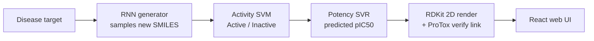

# MoleculeMind — AI for De-Novo Drug Discovery

Generate novel drug-like molecules for a target disease, then score each one for predicted
**activity** and **potency (pIC50)** — end to end, from a deep generative model to a web app.

> ⚗️ A full-stack research prototype: a character-level RNN proposes new molecules, two
> QSAR models filter them by predicted bioactivity, and a React front-end renders the
> structures with their predicted properties.

---

## What it does

1. **Pick a disease target** — the UI currently exposes Alzheimer's, HIV, Malaria and COVID-19.
2. **Generate molecules** — a character-level RNN samples brand-new SMILES strings (molecules
   that do not exist in the training set).
3. **Predict activity** — an SVM classifier labels each generated molecule *Active / Inactive*
   against the target.
4. **Predict potency** — an SVR model estimates the molecule's **pIC50** (binding strength).
5. **Visualise & verify** — RDKit draws the 2D structure, and each candidate links out to the
   [ProTox](https://tox.charite.de/protox3/) server for an independent toxicity check.



---

## Results (reported from the training scripts)

| Model | Task | Metric | Score |
|-------|------|--------|-------|
| Activity classifier (SVM + ECFP6) | Active vs. inactive | Test ROC-AUC | **0.82** |
| Activity classifier (SVM + ECFP6) | Active vs. inactive | Validation ROC-AUC | 0.80 |
| Potency regressor (SVR + ECFP6)   | pIC50 regression     | Test MSE | **0.68** |

*Figures are from the authors' own training runs (see the comments at the bottom of
`active_training.py` and `pic50_training.py`). Re-running training will reproduce them.*

---

## Data

QSAR models are trained on ~25,000 compounds pulled from **ChEMBL** across five targets —
**BACE1** (Alzheimer's), **Cyclooxygenase-2**, **HDAC1**, **HIV-1** and a **malaria** target
(cytochrome b). A compound is labelled *active* when its **pIC50 ≥ 6**.

The generative RNN is pre-trained on **23,853** drug-like SMILES (`Backend2/mols_filtered.smi`)
using a 50-token chemical vocabulary (`Backend2/Voc`).

---

## Tech stack

- **Generation:** PyTorch (character-level RNN over SMILES)
- **Cheminformatics:** RDKit (fingerprints, 2D depiction)
- **QSAR models:** scikit-learn (SVM / SVR on ECFP6 Morgan fingerprints)
- **Backend:** Flask + Flask-CORS (REST API)
- **Frontend:** React

---

## Repository layout

```
Backend2/
  model.py              # RNN definition
  data_structs.py       # SMILES vocabulary + dataset
  train_prior.py        # pre-train the generative RNN
  main.py               # RL fine-tuning toward a target (scoring functions)
  result.py             # sample new molecules from a trained model
  active_training.py    # train the activity (Active/Inactive) SVM
  active_prediction.py  # classify a molecule's activity
  pic50_training.py     # train the pIC50 (potency) SVR
  pic50_prediction.py   # predict a molecule's pIC50
  Rdkit_img.py          # render molecules to 2D images
  server.py             # Flask API (POST /mol)
  data/                 # ChEMBL datasets per target
frontend2/              # React web UI
```

---

## Getting started

### Backend

```bash
cd Backend2
python -m venv .venv && source .venv/bin/activate
pip install -r ../requirements.txt
python server.py          # serves the API on http://localhost:4005
```

### Frontend

```bash
cd frontend2
npm install
npm start                 # opens http://localhost:3000
```

> **Note — configuration:** this started as a local research prototype, so a few paths and the
> API URL are currently hard-coded (e.g. model checkpoint paths in `result.py` /
> `pic50_prediction.py`, and the backend URL in `frontend2/src/Component/page2.js`). Point these
> at your own checkout and running server before use. Moving them to environment variables is on
> the roadmap below.

---

## How the generator works

The molecular generator is adapted from **REINVENT** (Olivecrona et al., 2017,
*"Molecular De-Novo Design through Deep Reinforcement Learning"*) — a prior RNN is trained to
reproduce valid SMILES, then fine-tuned with reinforcement learning so that sampled molecules
score highly on a chosen objective (Tanimoto similarity to a query, a learned activity model, or
structural constraints).

On top of that generator, this project adds its own contribution: the **ChEMBL-trained activity
and potency (pIC50) models**, the **scoring / filtering pipeline**, the **Flask API**, and the
**React application** that ties generation, prediction and visualisation into one tool.

- Original method & reference code: [MarcusOlivecrona/REINVENT](https://github.com/MarcusOlivecrona/REINVENT) (Apache-2.0)
- Paper: Olivecrona, M., Blaschke, T., Engkvist, O., Chen, H. *J. Cheminform.* **9**, 48 (2017).

---

## Roadmap / known limitations

- [ ] Move hard-coded paths and the API URL into a `.env` / config file
- [ ] Add a `requirements.txt` with pinned versions and a quick-start script
- [ ] Package the trained models (currently large binaries) via Git LFS or an external download
- [ ] Add example outputs (generated molecules + predictions) to the README
- [ ] Report full metrics (precision/recall, enrichment) alongside ROC-AUC

---

## Disclaimer

This is a research and learning project. The generated molecules and predictions are **not**
validated for real-world use and must not be treated as medical or pharmacological advice.
